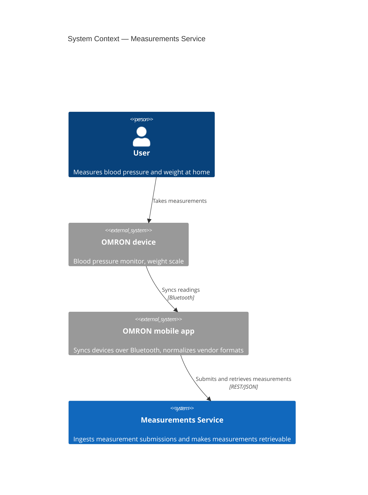
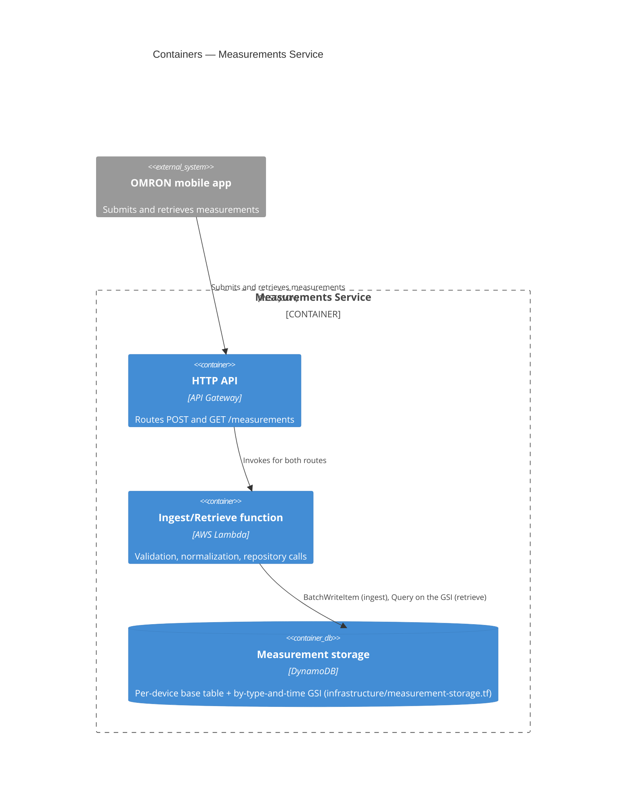
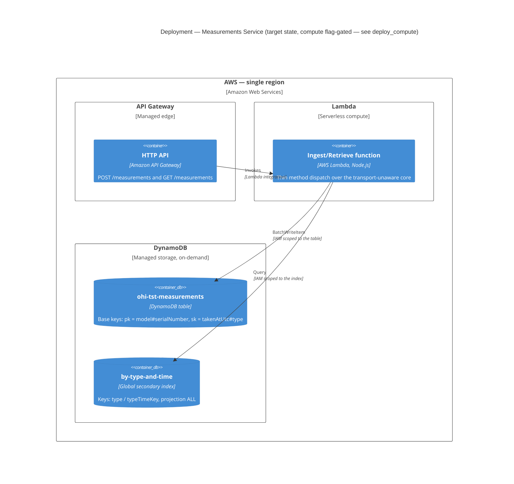

# Measurements Service — Candidate Submission

See [ASSIGNMENT.md](ASSIGNMENT.md) for the assignment. Structure your answers below.

## How to run

```bash
npm install
npm test
npm run lint
npm run build
```

Your implementation lives in the `services/measurements` workspace (`src/core/` for
domain logic, `src/entry/` for your compute adapter); tests go in `test/`.

This repo's Terraform is meant to be applied locally as you work, not just
validated, `npm run infra:up` starts a local AWS emulator, then `terraform apply`
from `infrastructure/` deploys your table design there so you're developing and
testing against something real, not just satisfying a linter. See
`infrastructure/README.md` for the full walkthrough. (The only strictly required
*checks* are `terraform validate`/`fmt`, see `AGENTS.md`, but applying locally as
you go is how this is meant to be worked, not extra credit.)

## 1. Architectural overview

### System context



### Containers



### Deployment

Target state — the DynamoDB table is what the LocalStack apply creates; the API
Gateway + Lambda + IAM compute plane ships in `infrastructure/measurement-ingest-api.tf`
but is flag-gated behind `deploy_compute` (default false), so it is not applied by
default (see §3).



### Rationale

**Serverless + on-demand, because the traffic is diurnal and bursty.** People measure
at home around morning and evening; between peaks an always-on fleet would idle. API
Gateway + Lambda + on-demand DynamoDB all scale to zero and price per request, so cost
tracks usage from the first day and peaks are absorbed by Lambda concurrency and
DynamoDB on-demand scaling rather than by capacity planning. For a lightweight service
with two routes, this is the smallest architecture that is still production-shaped.

**One function for both routes.** Ingest and retrieval share the same validation,
normalization, and repository modules; the handler is a thin method dispatch. A single
deployable keeps the artifact surface small and the two routes consistent, and at this
scale splitting into two functions buys nothing — no independent scaling or blast-radius
requirement exists yet (both routes hit the same table at modest traffic). Because the
dispatch is isolated at the edge of an otherwise transport-unaware core, splitting later
is mechanical if retrieval ever needs its own scaling or SLO profile.

**Synchronous write behind the 202.** The 202 here means *accepted and durably stored*:
the Lambda responds only after the BatchWrite has succeeded, so the acknowledgement never
outruns persistence. There is deliberately no queue. Delivery failure is already covered
on the device side — the fixtures are the evidence: retried pushes and re-syncs
re-deliver identical content — and §2's idempotent key design makes those re-deliveries
safe. Adding SQS in front would add a moving part and an eventual-consistency window
without providing durability the caller doesn't already provide itself.

**Cold starts are acknowledged, not ignored.** A Node.js Lambda on this path will
cold-start occasionally. For background sync traffic that is acceptable; if it ever
isn't, SnapStart or provisioned concurrency are configuration changes, not architecture
changes.

**Evolution paths and their triggers.** The design is the smallest thing that fits the
given perimeter, with identifiable exits:

- **SQS-buffered ingest** — when sustained write spikes push against per-partition limits
  (the GSI ingestion funnel discussed in §2), or when a second consumer wants the
  submission stream (fan-out). Idempotent writes make at-least-once queue delivery safe
  with no data-model change.
- **Container compute (ECS/EKS)** — when the service grows persistent connections,
  heavy compute, or a cold-start intolerance that provisioned concurrency can't fix.

Neither exit touches the table design — which is why the timebox was spent there
(ASSIGNMENT.md: *protect the data model*).

## 2. Data structure and flow

The only read the given perimeter offers is `GET /measurements?type&from&to`: every
measurement of **one type** inside a **time window**, across **all devices**. The only
write is a whole submission that **can arrive more than once**. The design below serves
exactly those two facts — the retrieval query and the duplicates problem.

### The table

`infrastructure/measurement-storage.tf` is the design artifact (on-demand billing,
name and tags from the label module — resolves to `ohi-tst-measurements`):

**Base table — one partition per device:**

| Key | Format | Purpose |
|-----|--------|---------|
| PK `pk` | `<model>#<serialNumber>` | Scopes one physical device's history |
| SK `sk` | `<takenAtUtc>#<type>` | Orders it chronologically; completes the natural key |

**GSI `by-type-and-time` — serves the retrieval query** (Projection ALL, so retrieval
never fetches back to the base table):

| Key | Format | Purpose |
|-----|--------|---------|
| PK `type` | `blood_pressure` / `body_mass` | One partition per measurement type |
| SK `typeTimeKey` | `<takenAtUtc>#<model>#<serialNumber>` | Time order across all devices; the suffix disambiguates same-instant readings and (as shown below) pins the range semantics |

**Item attributes:** `pk`, `sk`, `type`, `takenAtUtc`, `takenAtDevice`, `model`,
`serialNumber`, `values` (map, verbatim from the submission), `typeTimeKey`.

### Identity and the duplicates position

Submissions carry no identifier. Identity therefore comes from the data: the natural key
is **`model + serialNumber + takenAtUtc + type`** — the same device reporting the same
reading taken at the same instant *is the same measurement*, no matter which push
delivered it. The fixtures show re-delivery is real: `app-submission-blood-pressure-resync.json`
re-delivers a reading (`2026-08-25T21:18:03+02:00`) that also appears in the original
submission, byte-identical in content; the body-mass pair overlaps the same way.

**Position: idempotent last-write-wins.** The natural key is encoded directly into the
item key (`pk` + `sk`), so every write is a plain `Put`: a re-delivery rewrites the same
item with the same content, and any sequence of retries/re-syncs converges to exactly one
item. No conditionals, no deduplication table, no request-ID bookkeeping. Alternatives
weighed: a conditional put (`attribute_not_exists`) would turn benign retries into errors
the app must handle, and a separate dedup store adds state plus a race window to solve a
problem the key design solves for free. Last-write-wins is safe *because* re-delivered
content is identical; if submissions ever became mutable (edits, corrections), the position
would need revisiting — nothing in the given perimeter suggests they are.

### Why the composite partition key

Serial-number uniqueness **across models is not assumed** — nothing in the givens promises
OMRON never reuses a serial between two device models. Had `pk` been the bare
`serialNumber`, a cross-model collision would merge two devices' histories into one
partition, where writes overwrite and interleave each other's data: silent **corruption**.
With `pk = <model>#<serialNumber>`, the worst realistic failure is the opposite shape: if
a device's model string drifts (firmware rename, app-side restyling), its history
**fragments** across two partitions — recoverable, still queryable, never merged. Note the
retrieval path doesn't even key on `pk` (the GSI ranges on time), so type+window reads
return both fragments. Corruption vs. fragmentation: fragmentation is the lesser evil, so
the composite key is the defensive choice.

> **Documented assumption:** the app submits a **stable model string** — it is device
> identity, not free text. This is written down for future teams in §5.

### Why UTC normalization

Devices submit local timestamps with mixed offsets (the fixtures carry both `+02:00` and
`Z`). DynamoDB sorts keys lexicographically, and mixed-offset strings do **not** sort
chronologically — `2026-08-25T08:14:12+02:00` happened *before* `2026-08-25T07:00:00Z`
but sorts after it. So every timestamp is normalized to the fixed-width UTC format
**`YYYY-MM-DDTHH:mm:ss.SSSZ`** (built from explicit `getUTC*` parts, no locale APIs).
Fixed width means **lexicographic order = chronological order** — the property both `sk`
and `typeTimeKey` range queries rely on, and the reason results come back in time order
with no in-memory sorting. The original device-local string is preserved verbatim as
`takenAtDevice`: normalization serves the keys, never erases what the device said.

### Range semantics: `[from, to)`

A retrieval returns measurements with `from <= takenAt < to`. Two things make this exact
rather than approximate:

- DynamoDB's `KeyConditionExpression` allows **only one sort-key condition**, so
  `typeTimeKey >= :from AND typeTimeKey < :to` is not expressible. The query uses
  `BETWEEN :from AND :to` instead (inclusive at both ends).
- That inclusive upper bound would over-return — except **no key is ever a bare
  timestamp**: every `typeTimeKey` carries the `#<model>#<serialNumber>` suffix. An item
  taken exactly at `from` keys *above* the bare bound → included. An item taken exactly at
  `to` also keys above the bare `"<to>"` bound → *excluded* by the inclusive upper limit.

So `BETWEEN` over bare UTC bounds implements `[from, to)` precisely — half-open windows
tile a timeline with no gaps and no double-counting, which is what a syncing client needs.

### The read model

The retrieval side of `openapi.yaml` (the placeholder the assignment asked me to fill)
defines `Measurement` as `oneOf` `BloodPressureMeasurementRead` | `BodyMassMeasurementRead`
with `type` as discriminator. It mirrors the submission: `takenAt` (UTC-normalized),
`takenAtDevice` (original string, offset preserved), the `device` block (`model`,
`serialNumber`) echoed back, and `values` verbatim. Nothing is computed or joined at read
time — with Projection ALL the stored item *is* the response, minus its keys.

### Flow

**Ingest** — `POST /measurements`:

1. Handler parses the JSON body (malformed → 400).
2. `validateSubmission` enforces the contract: device present, non-empty `model`/`serialNumber`,
   at least one measurement, known `type`, parseable `takenAt`, per-type `values` rules
   (violations → 400 with the reason).
3. Each measurement is normalized: `takenAtUtc` in fixed format, `model`/`serialNumber`
   trimmed, `pk`/`sk`/`typeTimeKey` built by the key builders in `normalize.ts`.
4. Items are written with `BatchWriteItem` — plain puts, chunked at the 25-item API cap,
   re-sending any `UnprocessedItems` up to a bounded number of attempts, then failing loudly.
5. **202** once durably stored.

**Retrieve** — `GET /measurements?type&from&to`:

1. Params validated: all three required, `type` must be one of the two known types,
   `from`/`to` parseable, `from < to` (else 400).
2. **One Query shape** against the GSI: `type = :type AND typeTimeKey BETWEEN :from AND :to`,
   paginating internally on `LastEvaluatedKey` until exhausted.
3. **200** with a plain ascending-by-time JSON array (the public response shape the given
   perimeter specifies — pagination is an implementation detail, not part of the contract).

Known accepted edge: the batch-write retry is bounded but **without backoff** — adequate
for the harness and for on-demand DynamoDB's own retry headroom, but real production
throttling calls for exponential backoff with jitter (listed under *Before production*).

### Layout A vs. Layout B — the cost and scaling defense

Two layouts were considered:

- **Layout A — single per-type table.** PK = `type`, SK = `<takenAtUtc>#<model>#<serialNumber>`,
  no GSI. The retrieval query runs directly on the base table and every measurement costs
  one write.
- **Layout B — per-device base table + GSI (chosen).** The design above. Every measurement
  is written twice (base table + index replication), so writes cost roughly **2× A**.

Planning assumptions: planning scale **1M users × 3 measurements/day** with a **4× diurnal
peak**; us-east-1 on-demand pricing — **$1.25/M WRU, $0.25/M RRU, $0.25/GB-mo**; 24-month
retention.

| Scale | Writes/mo | A: writes | B: writes | Reads/mo (both) | Storage/mo @24mo retention (A / B) | A total | B total |
|---|---|---|---|---|---|---|---|
| 100k users, 2/day | 6M | $7.50 | $15 | ~$9 | ~$4 / $8 | ~$21 | ~$32 |
| 1M users, 3/day | 91M | $114 | $228 | ~$68 | ~$55 / $110 | ~$237 | ~$406 |
| 10M users, 3/day | 912M | $1,140 | $2,280 | ~$684 | ~$550 / $1.1k | ~$2,374 | ~$4,064 |

The B premium is real but small in absolute terms (~$170/mo at planning scale). What it buys:

- **A has a hard ceiling; B's base table doesn't.** With PK = `type`, *every* blood-pressure
  write for *every* user lands on **one partition**, and a DynamoDB partition serves at most
  ~1,000 writes/s. The 10M-user peak (~1,400 w/s) exceeds that, and the only fix is a full
  table redesign plus a data migration **under load**. B spreads base writes across one
  partition per device — effectively unbounded.
- **Honest nuance: B's GSI has the same funnel.** The index is also partitioned by `type`,
  so index replication hits the same ~1,000 w/s ceiling at the same 10M-user peak. The
  difference is the *path out*: sharding the index key (`type#NN`, with scatter-gather
  queries across shards) touches only the GSI key builder and the read path — cheap
  precisely **because B already decoupled the read key from the base key**. The base table,
  the items, and the ingest pipeline stay put. A has no equivalent escape without migrating
  the table itself.
- **B serves a second access pattern for free.** Per-device history ("show this scale's
  readings") is a single base-table Query — the natural next product screen, which under A
  would need another index or table.

B trades a modest, bounded write premium for a scaling path that is *incremental* (re-key
an index) rather than *existential* (migrate a table under load). That is the defense of
the chosen layout.

## 3. Implementation in TypeScript

### What was built

| Path | Role |
|------|------|
| `services/measurements/src/core/submission.ts` | Given ingest types mirroring `openapi.yaml` |
| `services/measurements/src/core/validate-submission.ts` | Transport-agnostic contract validation; `ValidationError` drives every 400 |
| `services/measurements/src/core/normalize.ts` | UTC normalization + all key builders — the single place the key contract lives |
| `services/measurements/src/core/table-definition.ts` | `CreateTable` shape used by tests; the TS mirror of `measurement-storage.tf` |
| `services/measurements/src/core/measurement-repository.ts` | Storage boundary: `MeasurementRepository` interface + DynamoDB implementation (idempotent batched writes, paginated GSI range reads, read-model mapping) |
| `services/measurements/src/entry/index.ts` | Lambda handler — method dispatch only; `createHandler` takes an injected repository for tests, the exported `handler` wires the real DocumentClient + `TABLE_NAME` (fails loudly at init if unset) |
| `openapi.yaml` | Retrieval-side `Measurement` schema filled in from the read model (`oneOf` + discriminator) |
| `infrastructure/measurement-storage.tf` | The required design artifact: table + GSI resource |
| `infrastructure/measurement-ingest-api.tf` | Bonus compute plane: API Gateway HTTP API + Lambda + least-privilege IAM, flag-gated behind `deploy_compute` (default false) — `terraform validate`-only |

The core is transport-unaware: nothing in `src/core/` knows about Lambda or API Gateway,
so every domain rule is directly testable in-process. The entry is deliberately dumb — it
translates events into calls and results into responses, maps `ValidationError` → 400 and
unexpected errors → 500 (details go to the logs, never into the response body).

### How to exercise it

- **`npm test`** — 51 vitest tests running against an **in-process DynamoDB**
  (`test/helpers/dynamodb.ts`, dynalite): real CreateTable/Put/BatchWrite/Query semantics
  with no Docker and no AWS account. Coverage includes normalization and mixed-offset
  ordering, every validation rule against the real fixtures, repository behavior
  (duplicate re-push converges to one item; re-sync overlap collapses; `[from, to)`
  boundaries; cross-model same-serial distinctness; empty ranges), and the handler driven
  by synthetic `APIGatewayProxyEventV2` events through its 202/200/400/404/500 paths.
- **`npm run lint` / `npm run build`** — oxlint and `tsc` across workspaces, green.
- **Terraform** — the table was not just validated but **applied to LocalStack**
  (walkthrough: `infrastructure/README.md`), then smoke-checked with the AWS CLI:
  `describe-table` shows the deployed base keys (`pk`/`sk`) and GSI keys
  (`type`/`typeTimeKey`) exactly as `table-definition.ts` creates them in tests.

### What was left out

- **Authn/z** — the given perimeter has none (no auth in `openapi.yaml`) and none was
  added; see *Before production* for what belongs in front of it.
- **A local apply of the compute plane** — the compute-side Terraform (HTTP API + Lambda +
  least-privilege IAM, `infrastructure/measurement-ingest-api.tf`) *shipped*, but
  flag-gated: `deploy_compute=false` by default so the required table-only LocalStack
  apply is unaffected. It is a `terraform validate`-only bonus — Lambda/API-Gateway
  emulation on LocalStack is out of scope — so flip the flag on in a real account or CI,
  not against the local endpoint. It packages the built `dist/` as a zip produced by CI
  and deliberately uses that pre-built-zip path rather than the `archive_file` data
  source, to avoid mutating the committed provider lock file (a deviation the file
  header self-documents).
- **Backoff on the batch-write retry** — bounded re-sends of `UnprocessedItems` without
  exponential backoff (acknowledged in §2).
- **A test for the throttling path itself** — the in-process harness never returns
  `UnprocessedItems`, so that retry loop is covered by review, not by a test.

## 4. AI usage

**Tool.** The [opencode](https://opencode.ai) CLI (an agentic coding tool), running model
`qwen3.8-max` for this session, working in a git worktree with small conventional commits
per task, using the obra/superpowers plugin for brainstorm / implementation approach.

**Workflow.**

1. **Brainstorming first, code never first.** Every design position in this README —
   identity and the duplicates stance, table layout B over A, the composite PK, UTC
   normalization, `[from, to)` semantics, the read model, the cost/scaling analysis — was
   surfaced as options with trade-offs, and I chose and defended each one before any
   implementation. The approved decisions were then locked in a written implementation plan
   that bound the execution phase.
2. **Subagent-driven execution.** For each plan task, a fresh implementer subagent wrote
   the failing tests first (RED), then the implementation (GREEN); an independent reviewer
   subagent then checked the result for spec compliance and code quality; a controller
   reconciled the findings. I reviewed the design decisions and the diffs as tasks landed.
3. **No position was auto-accepted.** The AI drafted; the decisions in §1–§2 (including
   the cost model's assumptions) were reasoned through with me.

**How the output was verified.**

- Every task was gated on `npm test`, `npm run lint`, `npm run build` staying green, with
  tests written before implementation (TDD). The suite runs against a real
  (in-process) DynamoDB, so key semantics — sort order, BETWEEN, BatchWrite — are exercised
  for actual behavior, not mocked assumptions.
- Terraform was `validate`d **and applied** against LocalStack, with AWS CLI smoke checks
  confirming the deployed key schema; the `openapi.yaml` change was validated by parsing
  the spec with a YAML parser and diffing the schema against the implemented read model.
- The verification loop caught two real defects **in the plan itself**: (1) DynamoDB
  permits only one sort-key condition, so the planned `>= AND <` key condition was not
  expressible — it was replaced with the `BETWEEN`-over-suffixed-keys formulation that
  provably yields `[from, to)` (§2); (2) the plan referenced
  `DynamoDBDocumentClient.fromClient()`, which does not exist in the installed SDK version —
  the correct factory is `.from()`. Both were caught by implementer subagents against the
  real library/table semantics, ruled on, and the plan amended.

## 5. What could another team leverage from this setup?

A second team shipping their own device integration (a thermometer, an ECG patch) gets
the most from the following.

**Reuse as-is:**

- **The natural-key idempotency pattern.** Derive identity from the data (device + instant +
  kind), encode it into the item key, write plain puts — re-delivery becomes safe with no
  dedup infrastructure, in any ingestion domain.
- **The validate → normalize → store pipeline.** Validation owns the contract (and the
  400s), normalization owns canonical form, the repository owns persistence — each
  independently testable, each replaceable without touching the others.
- **The thin-transport entry / transport-unaware core split.** The same core runs behind a
  Lambda handler today and behind an HTTP server, queue consumer, or CLI tomorrow.
- **The `table-definition.ts` ⇄ `.tf` mirroring convention.** Tests create the same shape
  Terraform deploys. The two are kept in sync by cross-referencing comments in both files
  plus the LocalStack post-apply `describe-table` smoke check — there is no automated
  parity test (tests only ever see the TS definition), so change one, change the other.
- **The in-process DynamoDB harness** (`test/helpers/dynamodb.ts`). Real key semantics in a
  plain `npm test` — no Docker, no AWS account, no credentials. The single biggest
  contributor to fast, trustworthy tests here.
- **The label-module naming/tagging** (`infrastructure/main.tf`): resources take their
  names and tags from `module.label.id` / `module.label.tags` instead of hand-rolled
  strings.

**What I would change to make reuse easier:**

- **A measurement-type registry.** The two types are currently hard-coded in several places
  (submission types, validation rules, the handler's type check, the openapi `oneOf`). A
  registry — one entry per type carrying its discriminator value and values schema — would
  let a new device type land as configuration + one schema instead of scattered code edits.
- **Extract the core as a library or template repo.** The pipeline shape, key builders,
  harness helper, and handler skeleton are all domain-agnostic; only the type-specific
  validation and read schemas should be pluggable.
- **Per-team-table vs. shared-table guidance.** This design shares one table across types
  safely (`type` is a first-class key component; `values` is a per-type map). A second team
  can either join this table — cheapest, with a shared scaling budget — or clone the
  pattern into their own (isolation, independent retention and scaling). If they join,
  note the type+time-window retrieval path reads through the `by-type-and-time` GSI, and
  GSI reads are always **eventually consistent**: strongly-consistent reads are only
  available on base-table queries (e.g. a single device's own history by `pk`). That
  decision should be deliberate; I'd default to a separate table whenever lifecycle or
  compliance differs.

**What I would write down for them (the gotchas):**

- **The model string is device identity.** Keys assume it is stable across submissions
  (`<model>#<serialNumber>`); a renamed or restyled model string fragments a device's
  history (§2). It is not free text — never "clean it up" without a migration plan.
- **`#` is the key separator — `device.model` and `device.serialNumber` must not contain
  it.** An embedded `#` could make two different devices' keys collide: exactly the
  corruption the composite PK defends against (§2). Rejecting `#` in those fields is a
  production validation/hardening item — the current validator trims but does not yet
  reject it.
- **The key contract lives in `normalize.ts`, in one place only.** Every key format (`pk`,
  `sk`, `typeTimeKey`) and the fixed UTC timestamp format are built there and mirrored by
  `measurement-storage.tf`. Change one, change the other, and re-run the boundary tests.
- **The duplicates position:** idempotent last-write-wins plain puts. Don't introduce
  conditional writes without revisiting the re-delivery story they'd break.
- **Range semantics are `[from, to)`** — exact via `BETWEEN` over suffixed keys (§2).
  Windows tile with no double-counting; any new read path must preserve that.

## Before production

What I would add before this handles real traffic — it is health data, so the bar is higher
than a generic CRUD service:

- **Authn/z.** The given perimeter has none. Put Cognito (or an equivalent IdP) in front of
  app traffic, API keys + WAF for partner traffic. Note the perimeter has no notion of a
  user at all — `GET /measurements?type&from&to` is global across devices — so until
  per-user retrieval is designed, access control can only live at the edge; that design
  (and likely a per-user index) is the first real feature after auth.
- **Rate limiting and throttling.** API Gateway throttling, Lambda reserved concurrency,
  and DynamoDB usage alarms — protection for the service and for the ~1,000 w/s GSI
  ingestion funnel (§2) against misbehaving client fleets.
- **Backups and retention.** Enable PITR; make the 24-month retention assumption real with
  a TTL policy or export/archive path, plus an erasure-request (GDPR-style) story.
- **Observability.** X-Ray (or OTel) tracing across API GW → Lambda → DynamoDB; CloudWatch
  alarms on 4xx/5xx rates, durations, throttled/unprocessed writes, and GSI replication
  lag; per-route dashboards.
- **Async ingest + DLQ when the spikes demand it.** The SQS-buffered evolution from §1 —
  with a DLQ and redrive policy — triggered by sustained write pressure on the GSI funnel
  or the arrival of a second consumer. The idempotent writes already make at-least-once
  delivery safe.
- **Load testing.** Sustained-peak and burst profiles against a production-shaped table,
  explicitly including the per-type GSI ingestion funnel — and validating the sharded-key
  scatter-gather design *before* it is needed, not during the incident.
- **CI/CD.** A pipeline running `npm test` / `lint` / `build` plus `terraform fmt`,
  `validate`, and `plan` on every PR, with gated `apply` per environment; the repo's
  pre-commit hooks are a local convenience, not a guarantee.
- **Request logging with PII care.** Measurements are sensitive health data: log request
  metadata and identifiers, never `values` bodies; access-controlled log storage with a
  retention policy matching the data policy.
- **Backoff on batch-write retries.** Exponential backoff with jitter on `UnprocessedItems`
  re-sends (currently immediate and bounded), matching whatever the SDK-level retry config
  ends up being.
